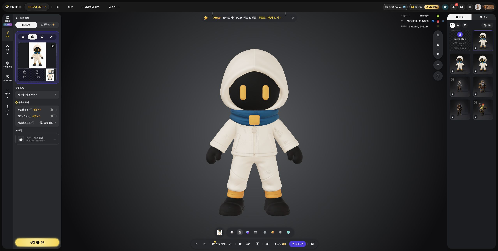

# Deviant Modeling

Tripo로 만든 주인공에 Kimodo 모션을 적용하고, Blender에서 게임용 도트 스프라이트로 렌더링하는 프로젝트입니다.

## 시작하기

- **갤럭시북 작업자:** [START-HERE.md](START-HERE.md)를 읽고 Kimodo 첫 걷기 검증을 진행합니다.
- **현재 상태:** [STATUS.md](STATUS.md)
- **상세 배경과 설치 예시:** [Kimodo 인계 문서](docs/KIMODO_HANDOFF.md)
- **공통 작업 지침:** [AGENTS.md](AGENTS.md)
- **컴퓨터 간 파일 전달:** [동기화 안내](docs/WORKFLOW.md)

## 역할

| 도구·장소 | 담당 |
|---|---|
| Tripo | 참고 이미지에서 캐릭터 외형 생성 |
| Kimodo / 갤럭시북 RTX 4050 6GB | 프롬프트에서 골격 모션 생성 |
| Blender / 맥 | 메시 정리, 리깅, 모션 이식, 보정, 렌더링 |
| GitHub | 코드·문서·선별한 모델 및 모션 결과 공유와 변경 이력 |
| Codex 클라우드(선택) | 설치 스크립트와 도구 작성, 코드 검토·수정, 가능한 검증 |

GitHub에 저장한 결과를 각 컴퓨터에서 받습니다. Codex 클라우드 작업 공간에만 남은 변경은 다른 컴퓨터에 자동으로 전달되지 않습니다. 클라우드는 필수 단계가 아닙니다.

## 현재 캐릭터

현재 원본은 [ink-hero.glb](assets/ink-hero.glb)입니다. 아이보리 둥근 후드와 짧은 집업, 청록색 스카프, 검은 얼굴과 금색 눈을 가진 작은 캐릭터입니다. 망토와 긴 스카프 꼬리는 제거했습니다. 첫 무기는 검을 계획하고 있습니다.

GLB는 약 60MB의 고밀도 메시이며 뼈대와 애니메이션은 없습니다. Kimodo 골격 모션 생성과 주인공에 적용하는 작업은 별도 단계입니다. 이전 절차적 Blender 모델은 이 저장소에 포함하지 않습니다.

## 당장 할 일

현재는 사용자가 기존 모델의 어깨 변형을 다시 지적하여 **몸통·소매·하체를 새로 제작한 기준 모델**로 전환했습니다. [새 기준 자세](outputs/hero-model-front.png), [편집용 모델](outputs/hero-model.blend), [GLB](outputs/hero-model.glb), [관절 시험 영상](outputs/hero-model-deformation-preview.mp4)을 확인합니다. 후드·얼굴·색감은 유지하며 팔은 T자, 다리는 약 23도 벌려 관절을 배치했습니다. 새 모델에는 아직 Kimodo 달리기를 적용하지 않았습니다. 재실행과 검사 범위는 [아래 모델 재작업 기록](docs/SIDE_REVIEW.md)을 참조합니다. 아래 달리기 기록은 이전 모델의 경과입니다.

[측면·소형 해상도 검토와 보정](docs/SIDE_REVIEW.md)에서 발목·하체, 팔 경로·손목, 후드 방향과 신발·옷 연결을 다듬었습니다. [같은 측면의 수정 전후 비교](outputs/hero-run-side-motion-comparison.gif)와 [128·96·64 캔버스 비교](outputs/hero-run-side-scale-comparison.gif)를 확인합니다. 최종 도트 미술 정리와 일부 국소 옷 변형은 남아 있습니다.

최신 비교는 어깨·몸통 연결 보정 전후입니다. 기존 16뼈의 크기를 유지하고 쇄골 뼈 두 개와 연속적인 어깨 옷 가중치를 추가했습니다. 가슴은 골반과 반대로 움직이며, 과한 숙임과 바쁜 박자를 줄여 0.6초 주기·3초 다섯 주기로 정리했습니다. 전후 비교는 도트 축소 없이 원본 384픽셀 측면 렌더를 사용합니다. 에테르 입력 후보는 비교 글자가 없는 `hero-run-side-preview.mp4`이며, 아직 외부 서비스로 전송하지 않았습니다.

게임 기본 이동용으로 [달리기 생성·적용](docs/RUN_RESULT.md)도 진행했습니다. [달리기 미리보기](outputs/hero-run-preview.mp4), [편집용 Blend](outputs/hero-run.blend), [달리기 GLB](outputs/hero-run.glb)를 사용합니다. 캐릭터 크기는 기존 걷기와 같고, 달리기의 공중 구간과 반복 경계를 별도로 처리했습니다.

`work/kimodo-setup`에서 갤럭시북의 CPU 텍스트 인코더·RTX 4050으로 3초 걷기 골격 생성과 NPZ/BVH 실제 재생 검증을 완료했습니다. [실행 결과와 재실행 방법](docs/SETUP_RESULT.md), [3초 미리보기](outputs/walk-preview.mp4)를 확인할 수 있습니다.

갤럭시북 Blender에서 캐릭터 비율의 몸통 리그와 걷기 첫 적용본도 만들었습니다. [캐릭터 걷기 영상](outputs/hero-walk-preview.mp4), [작업 기록](docs/HERO_WALK.md), [편집용 Blend](outputs/hero-walk.blend), [애니메이션 GLB](outputs/hero-walk.glb)를 확인할 수 있습니다. 원본 `assets/ink-hero.glb`는 보존했습니다. 다음은 의상·발 접촉과 반복 동작 보정 후 카메라 방향별 2D 렌더링을 비교하고 에테르 AI의 도트 변환을 검토하는 작업입니다.

## 파일 관리

파일명은 유지하고 변경 이력은 Git에 남깁니다. 가상환경·가중치 캐시·토큰·설치 프로그램은 올리지 않습니다. 현재 GLB는 초기 전달 편의를 위해 일반 Git으로 관리합니다. 큰 바이너리를 반복 수정하기 전 Git LFS 또는 별도 아티팩트 저장소로 전환을 검토합니다. 본 프로젝트 전체에 별도 오픈소스 라이선스를 선언한 상태는 아닙니다. Kimodo 및 각 모델의 이용 조건은 각각 확인해야 합니다.
